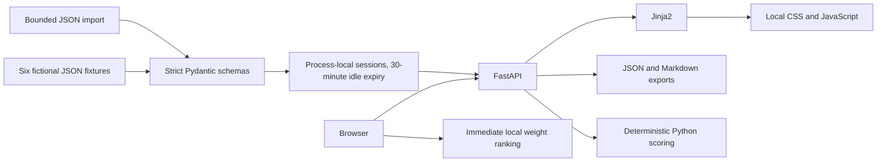

# Architecture

`atelier/schemas.py` defines the shared studio, context and section contracts. Model validation checks journey order, unique IDs, complete scores, all referenced sources and workflow steps, grounded profile claims, risk presence and weights. `atelier/scoring.py` normalizes weights and ranks by score, safety, time to value, then ID. The browser uses the same formula; the test report records a browser check against the Python result.

`atelier/store.py` holds bounded, isolated sessions. Cookie tokens are random and HttpOnly. A lifespan task sweeps idle sessions every 30 seconds, and every lookup rejects expired data. Active user interaction sends an occasional heartbeat. A server restart removes all sessions. This design requires a single worker and has no durability guarantee; explicit exports provide persistence.

`app/main.py` serves templates, fixtures, session data, imports and exports. Inputs are bounded; validation errors never echo submitted content. Mutating requests require the app's own Origin. Pages are noindex and no-store. API credentials, live generation, external searches and message sending are absent.

Sample context replaces the complete session with a prewritten variant, preserving deterministic reversibility. M3 will add layer dependencies, conflict handling, editing, locking and actual incremental recomputation.
