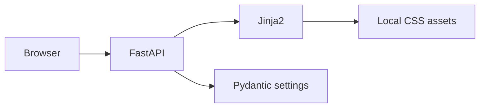

# Architecture

M0 serves a demo shell and health, status, privacy and report pages. No database, session, generation or outbound service is configured. Future stages, context models, scoring and sessions belong in `atelier`; routes and presentation belong in `app`. Static showcase generation is planned for M4.
