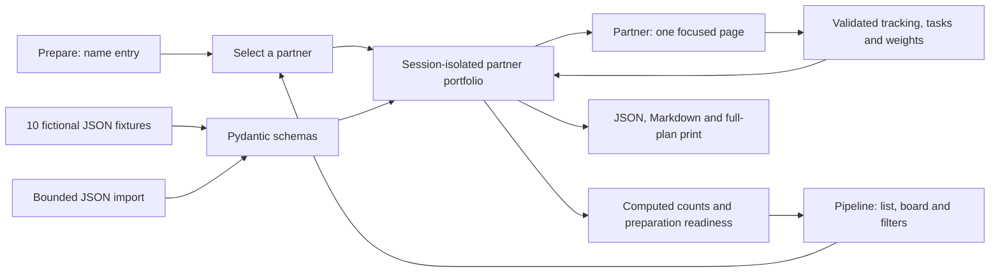

# Architecture

`atelier/contracts.py` supplies common bounded contracts. `schemas.py` defines grounded studio sections; `tracking.py` defines the optional operational record, task list, event and validated updates. Unknown evidence references, incomplete scores, invalid journey order and over-confirmed or over-completed counts are rejected.

`store.py` keeps a portfolio in each isolated server session. A selected partner is a pointer inside that portfolio, so navigation preserves other partners' data. Imports replace an identically identified partner or add a new one; explicit sample-context switching retains existing tracking and weights while replacing prewritten content. Data is deep-copied at access boundaries. Storage is bounded to 100 sessions, 12 partners and 3 MB per workspace.

`pipeline.py` aggregates current-stage counts, preparation states, open tasks and future experiences. It computes these from session records; no telemetry, forecasts or external calendar is involved. Filters affect the directory, while summary counts describe the whole workspace.

`app/main.py` serves three primary surfaces. `/studio?view=...` validates a page whitelist and includes only the selected content partial. `/studio/print` is the explicit full-content route. The browser handles dialogs, clipboard, local ranking, tracking forms and task updates through same-origin POST endpoints.

The 30-minute idle lifecycle, HttpOnly SameSite cookie, optional Secure cookie under HTTPS, strict CSP, no-store/noindex pages and no body logging remain. A lifespan task sweeps expired sessions every 30 seconds; any expired lookup fails immediately. Use one worker. Exports are explicit persistence; there is no automatic browser backup or database.
